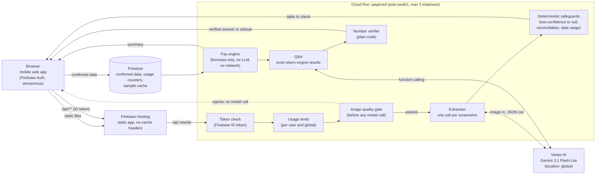

# PayProof architecture

Gemini reads screenshots and explains results. Fixed formulas in `engine/` do every calculation. No model or network call exists anywhere in `engine/`.

## Request flow

1. The browser signs in anonymously with Firebase Authentication and sends the ID token with every `/api` call. Hosting serves the app and rewrites `/api/**` to Cloud Run. The backend takes the user id only from the verified token.
2. **Screenshot.** The usage limit is checked, then the image-quality gate. An image that fails never reaches Gemini or the counters. A passing image is resized in memory and sent in one Gemini call (at most one retry on invalid output). The safeguards then null any field the model marked low-confidence, any table whose money fields do not reconcile, any date outside 2020-01-01 to today, and zero distance or minutes. The image is never stored.
3. **Check.** The worker compares the table with their own screenshot and confirms it. Only confirmed data is written to Firestore, under the user's id.
4. **Results.** `engine/` computes every figure from the stored data and the worker's own costs.
5. **Ask.** Gemini receives the question and three read-only tools that return engine results. The draft answer passes through the number verifier and a content-policy check. One stricter retry is allowed, and then a fixed refusal replaces the answer.

## Cost controls

We pay for every Gemini call. Values below are the deployed settings in `deploy/env.yaml`.

| Control | Setting |
|---|---|
| Model | `gemini-3.1-flash-lite` for extraction and answers (cheapest of the candidates that met accuracy) |
| Calls per screenshot | One, with at most one retry on invalid output; a short pause-and-retry on a 429 or 5xx, then a friendly busy message; no loops |
| Image preparation | Longest side at most 1280 px, JPEG quality 85, metadata stripped, in memory |
| Upload limit | 8 MB, checked in the browser and on the server |
| Output caps | 1,500 tokens for extraction, 400 for answers; temperature 0; minimal thinking |
| Quality gate | Blurry, dark, low-contrast or tiny images are rejected before any model call |
| Q&A | Compact engine JSON only, never images or histories; at most two model turns per question; the verifier is plain code |
| Per-user daily limits | 12 extractions and 25 questions, as atomic Firestore counters |
| Global daily limit | 400 Gemini calls, as an atomic Firestore counter |
| Caching | In-memory cache by image hash (500 entries per instance); curated sample images (simulated) cached in Firestore, so repeat sample taps cost nothing |
| Cloud Run | `--max-instances=3`, 1 GiB, 60 s timeout, minimum instances 0 unless changed by the owner |
| Logging | Token counts and estimated cost per call only |
| Tests | Mocked Gemini output; evaluation scripts print the call count and estimated cost and wait for approval |
| Budget alert | Set in Google Cloud billing; it warns but does not stop spending, so the in-app limits are the real guard |
