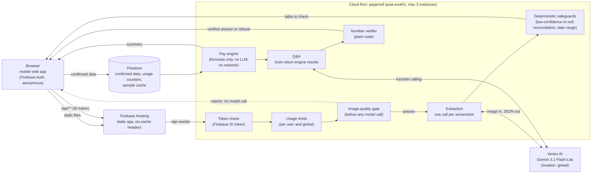

# PayProof architecture

Gemini reads screenshots and explains results. Fixed formulas in `engine/` do every calculation. No model or network call exists anywhere in `engine/`.

## Request flow

1. The browser signs in anonymously with Firebase Authentication and sends the ID token with every `/api` call. Hosting serves the app and rewrites `/api/**` to Cloud Run. The backend takes the user id only from the verified token.
2. **Screenshot.** The usage limit is checked, then the image-quality gate. An image that fails never reaches Gemini or the counters. A passing image is resized in memory and sent in one Gemini call (at most one retry on invalid output). The safeguards then null any field the model marked low-confidence, any table whose money fields do not reconcile, any date outside 2020-01-01 to today, and zero distance or minutes. The image is never stored.
3. **Check.** The worker compares the table with their own screenshot and confirms it. Only confirmed data is written to Firestore, under the user's id.
4. **Results.** `engine/` computes every figure from the stored data and the worker's own costs.
5. **Ask.** Gemini receives the question and three read-only tools that return engine results. The draft answer passes through the number verifier and a content-policy check. One stricter retry is allowed, and then a fixed refusal replaces the answer.

## Cost controls

We pay for every Gemini call. Each row names the file and line that backs it (line numbers as of this commit).

| Control | Setting | Proof |
|---|---|---|
| Model | `gemini-3.1-flash-lite` for extraction and answers | `deploy/env.yaml:12-13` |
| Calls per screenshot | One call, at most one retry on invalid output, then a safe fallback | `extraction/extract.py:357` |
| Transient errors | A 429 or 5xx is retried after at most 2 short pauses, then a friendly busy message | `extraction/extract.py:280`, `backend/qa.py:286-293` |
| Image preparation | Longest side at most 1280 px, JPEG quality 85, metadata stripped, in memory | `deploy/env.yaml:14-15`, `extraction/image_prep.py:11-22`, `backend/main.py:73` |
| Upload limit | 8 MB, checked in the browser and on the server | `deploy/env.yaml:16`, `backend/main.py:68-70`, `frontend/app.js:487` |
| Output caps | 1,500 tokens for extraction, 400 for answers | `deploy/env.yaml:17-18`, `extraction/extract.py:318`, `backend/qa.py:258` |
| Temperature and thinking | Temperature 0 (set for models that support it), `MINIMAL` thinking level | `extraction/extract.py:319,323`, `backend/qa.py:259,263` |
| Quality gate | Runs before the usage-limit counter and any model call | `backend/main.py:79` (gate) and `:122` (counter), `extraction/image_quality.py:28`, thresholds `deploy/env.yaml:23-27` |
| Q&A | Compact engine JSON only; draft plus at most one stricter retry; the verifier is plain code | `backend/qa.py:89`, `:808` (retry), `:544` (`verify_numbers`) |
| Per-user daily limits | 12 extractions and 25 questions, atomic Firestore transaction | `deploy/env.yaml:20-21`, `backend/main.py:122,422`, `backend/usage_limits.py:66` |
| Global daily limit | 400 Gemini calls | `deploy/env.yaml:22`, `backend/main.py:117` |
| Image-hash cache | In-memory, first-in-first-out, 500 entries per instance | `backend/extraction_cache.py:11,26`, `backend/main.py:119,137` |
| Sample cache | Curated simulated samples are cached in Firestore and not charged to the user | `backend/main.py:103-111,135`, `backend/sample_cache.py:18` |
| Cloud Run size | `--max-instances=3`, 1 GiB, 60 s timeout (deploy command) | `CLAUDE.md:65` |
| Minimum instances | Deployed value is 0. The owner may raise it to 1 during the judging window | `docs/PHASE6_REPORT.md:9,150` |
| Logging | Token counts, outcome and estimated cost per call only | `extraction/extract.py:72-76` |
| Evaluation scripts | Print the call count and estimated cost, then wait for `--go` | `eval/run_extraction_eval.py:7` |
| Tests | Gemini output is mocked, no network | `tests/test_extraction.py:1` |
